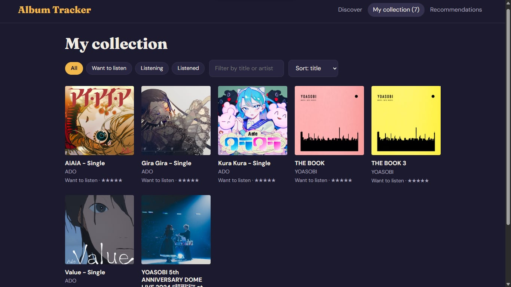

# Album Tracker

A full-featured React application for discovering music, organizing your personal album collection, listening to track previews, and receiving AI-powered music recommendations.



**Live site:** https://album-tracker-inky.vercel.app/

## Features

- Search albums and artists with the iTunes Search API
- Album page with cover, year, genre, track list, and links to Spotify, YouTube, and Apple Music
- 30-second track previews with a mini player (play/pause, previous/next, seek) that keeps playing while you browse
- My collection: save albums with a status (Want to listen, Listening, Listened), a 1-5 star rating, and notes, with filtering and sorting
- Optional full-album playback through Deezer's embedded player
- LLM-powered recommendations based on the user's saved albums and ratings

## Tech stack

React, Vite, Context API, iTunes Search API, Deezer API and widget, Google Gemini API, Vercel serverless functions, Vercel hosting

## Run it locally

```bash
git clone https://github.com/Zei06Logronio/album-tracker
cd album-tracker
npm install
npm run dev
```

Open http://localhost:5173 in a regular web browser.

## Limitations

- Previews are 30 seconds long because that is all the iTunes API provides.
- Your collection is saved only in your browser (localStorage), so it is not synced across devices.
- Deezer plays full tracks only if you are logged in to Deezer in the same browser and your plan includes full tracks in your country. The app cannot detect this.
- Audio playback requires a standard web browser; embedded editor previews may block it.

## Privacy

The recommendations feature sends your saved albums' titles, artists, ratings, and statuses to Google's Gemini API. Your notes are not sent. The API key is stored only as a server-side environment variable and is never exposed to the browser.

## Disclaimer

This is a learning project and is not affiliated with Apple, Spotify, Deezer, or Google. Music data, artwork, and audio belong to their owners.